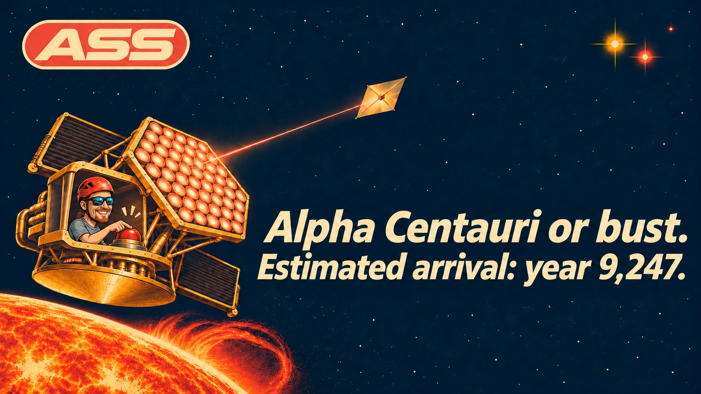

# ASS: Alpha centauri Solar Sail

<!-- Hero image goes here once generated, see docs/IMAGE_PROMPTS.md:

-->

> **Mission status:** 4.34 light-years to go. Spacecraft: none. Sail: none. Budget: none.
> Test coverage: 100%.

This project is meant to be absurd. Its acronym is **ASS**, and that is the most defensible
engineering decision in the repository.

The goal is to get a solar sail from the Sun to Alpha Centauri. Humanity cannot do this today. We
are writing the software anyway, so that on the day someone finally builds the hardware, they will
find the code already waiting for them, fully tested, thoroughly documented, and several centuries
out of date.

## The experiment

ASS is also a long-running experiment in **daily agentic development** on a goal that cannot be
finished. Most projects end when the work is done or when the money runs out. This one has a
destination 41 trillion kilometres away, so neither is likely to come up soon.

Every day, an AI agent wakes up on a laptop and:

1. reads what it did yesterday, because it does not remember,
2. checks what humanity has invented since then,
3. ships one small, tested piece of the mission software,
4. adds to its [ideas for wider improvements](docs/PROPOSALS.md), like new MCP connections to arXiv
   and astronomy forums,
5. adds to the [shopping list of hardware](docs/HARDWARE.md) it will eventually need, such as a
   robot, a laser or a star,
6. writes it all down in the [development log](docs/DEVLOG.md) and goes back to sleep.

The project is meant to outlive its tools. When better LLMs arrive, they take over the job. When
someone invents better sail materials, the numbers get updated. The questions we are testing:

- What does a codebase look like after thousands of unsupervised daily iterations?
- Can an agent keep a sense of direction when the finish line is out of reach?
- How long until it starts filing tickets against the Sun?

The agent writes the code, a human reviews it, and the universe remains unmoved.

## What is a solar sail?

A rocket throws mass out of the back. A solar sail skips the mass and uses sunlight.

Photons have no mass, but they do carry momentum, so a mirror that reflects them gets a tiny push.
At Earth's distance from the Sun that push is about **9 micronewtons per square metre**, roughly
the weight of a grain of sand spread over an area the size of a large desk. It is pathetic, but it
is also free, it never runs out, and in space nothing stops it from adding up.

The sails that have really flown include:

| Mission | Year | Claim to fame |
|---|---|---|
| IKAROS (JAXA) | 2010 | First solar sail to work in interplanetary space |
| NanoSail-D (NASA) | 2010 | First NASA sail in orbit, after its sibling was lost in a launch failure |
| LightSail 2 (The Planetary Society) | 2019 | Raised its orbit using sunlight alone, on a budget raised from the public |
| ACS3 (NASA) | 2024 | Tested lightweight composite booms |

The number that matters is **lightness**: the push of sunlight divided by the pull of the Sun's
gravity. Both weaken with distance at the same rate, so a sail with lightness above 1 is repelled
by the Sun everywhere in the solar system. That takes about 1.5 grams per square metre for the
*whole spacecraft*, payload included. LightSail 2 came in around 156.

The best known trick is the **sundiver**: fall towards the Sun with the sail edge-on, then turn it
face-on at the last moment, when the light is fiercest. The difficulty is doing this without
melting, which is why `ass` will sometimes congratulate you on inventing a very expensive comet.

## Where are we going?

Alpha Centauri is the closest star system to the Sun, in the southern constellation of Centaurus.
It has three stars:

| Star | Type | Distance | Notes |
|---|---|---|---|
| **Alpha Centauri A** | Yellow G-type, a little bigger than the Sun | 4.34 ly | The third-brightest star in the night sky, with its companion's help |
| **Alpha Centauri B** | Orange K-type, a little smaller than the Sun | 4.34 ly | Orbits A every 80 years, at 11 to 36 times the Earth-Sun distance |
| **Proxima Centauri** | Red dwarf | 4.25 ly | **The closest star to the Sun.** Tiny, faint and prone to violent flares |

Proxima hosts at least two confirmed planets. **Proxima b** is about the mass of Earth and orbits
within the habitable zone, although "habitable" is optimistic for a world under constant flare
bombardment. Alpha Centauri A also has a possible giant planet, spotted by JWST in 2025 and still
awaiting confirmation.

For scale: Voyager 1, humanity's most distant spacecraft, would need more than 70,000 years to
cover the same distance, and it is not even pointed the right way.

## So how long will it take?

Ask the software. It runs today and it has no interest in your feelings:

```console
$ uv run ass --areal-density 0.1
Target:        Alpha Centauri A
Lightness:     14.547 (above 1, the Sun pushes harder than it pulls)
Cruise speed:  508 km/s (0.169% of c)
Capture limit: 626 km/s
Peak temp:     853 K (melts at 933 K)
Flight time:   2,462 years
Arrival:       year 4,488
Verdict:       CAPTURE: the sail can brake on starlight and stay
```

All runs below dive to 0.1 AU from the Sun:

| Spacecraft (grams per m², payload included) | Cruise speed | Flight time | Verdict |
|---|---|---|---|
| 156 g/m², LightSail 2 class | 13 km/s | Never | Alpha Centauri moves sideways at 23 km/s and simply outruns it |
| 1 g/m², which nobody can build | 161 km/s | 7,221 years | Arrives and stays |
| 0.1 g/m², which nobody can even imagine building | 508 km/s | 2,462 years | Arrives and stays |

Please pack accordingly.

There is also a Plan B. Alpha Centauri is drifting towards us and will come within about 3 light
years in roughly 27,000 years. The software tracks this as `Star.closest_approach()`. It will not
come much closer than that, so we still need the sail.

## What exists today

| Module | What it does |
|---|---|
| `ass.bodies` | The Sun and the three Centauri stars, with positions and motion through space |
| `ass.sail` | Radiation-pressure thrust, lightness and equilibrium temperature |
| `ass.trajectory` | Sundiver speed and a numerical integrator that checks the formula |
| `ass.mission` | Aiming at where the star will be on arrival, braking feasibility, and a verdict |
| `ass.cli` | The `ass` command, for finding out how late you will arrive |

Everything else is on the [roadmap](docs/ROADMAP.md). It is a long roadmap.

## Quick start

You need [uv](https://docs.astral.sh/uv/). A spacecraft is not required at this stage.

```bash
uv sync
uv run pytest      # fails below 100% line and branch coverage
uv run ass --help
```

## Known limitations

- The spacecraft does not exist.
- The numbers are first-order estimates. The model has no flares, dust, sail degradation or
  gravity from Alpha Centauri B, and it treats a kilometres-wide mirror as a perfect flat sheet.
- At the time of writing, the maintainers are not expected to be alive at arrival. Contributions
  from descendants are welcome.

## License

[MIT](LICENSE). If you use this software to reach Alpha Centauri, attribution would be nice.
A postcard would be nicer. Allow 4.34 years for delivery.
